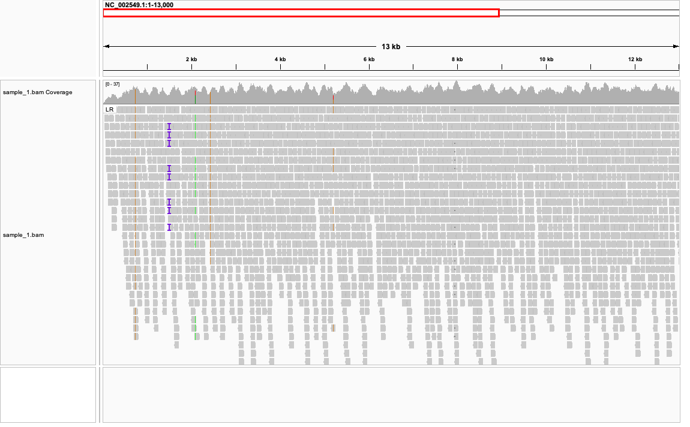
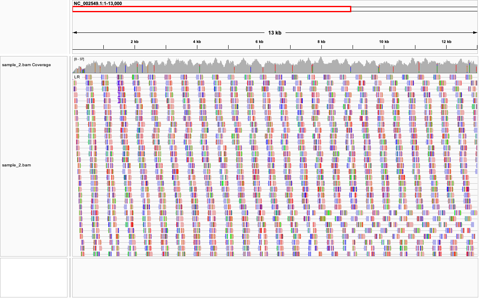
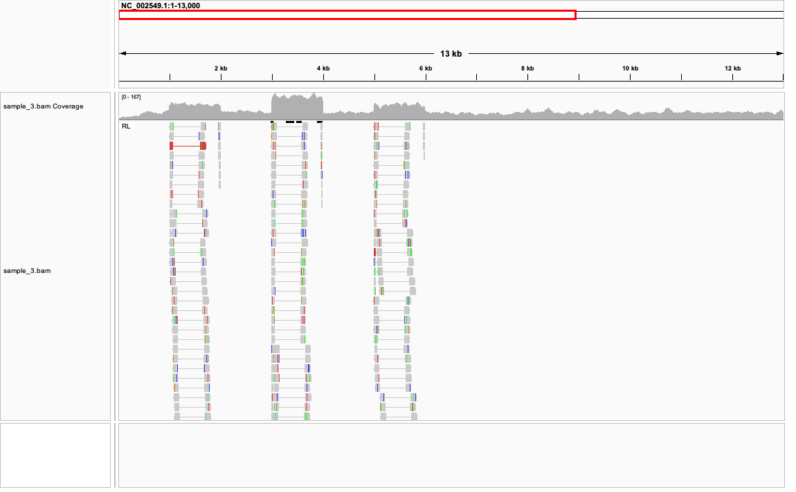
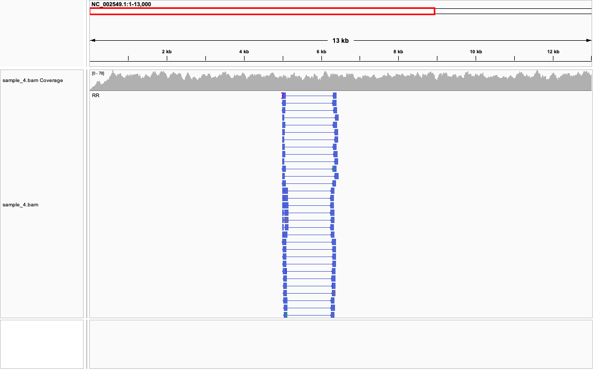
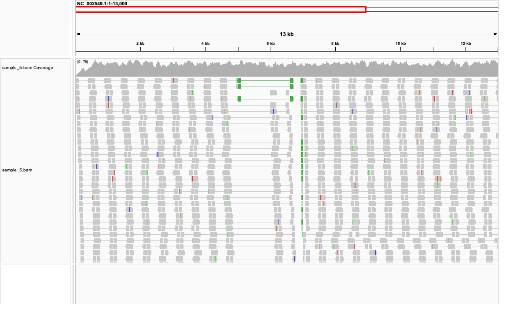

# Week 06: Evaluate Structural Variants

In this assignment, I used IGV to examine paired-end read alignments from five samples aligned to the Ebola virus reference genome (NC_002549.1). I viewed the reads as pairs and examined insert size, read strand, and pair orientation to identify possible sequence and structural variation.

## Sample 1

I viewed Sample 1 as paired reads and examined the insert size and pair orientation. Most read pairs appeared to align normally, and the coverage was fairly continuous. However, I observed multiple insertion markers (`I`) supported by several reads, including a clear group near 15 kb. My best interpretation is that Sample 1 contains small insertions relative to the reference, but there is no obvious large structural variant.

## Sample 2

I viewed Sample 2 as paired reads and checked the read strand, insert size, and pair orientation. There were many colored bases throughout the alignment, indicating differences between the reads and the reference sequence. However, I did not see a clear cluster of abnormal read-pair orientations or spacing that would indicate a large structural variant. My best interpretation is that Sample 2 contains many sequence-level differences from the reference, although some could also be caused by sequencing or alignment errors.

## Sample 3

I viewed Sample 3 as paired reads and examined the insert size and pair orientation. A group of read pairs showed an abnormal orientation compared with the usual paired-read pattern. This suggests a structural rearrangement in this region. Based on the orientation of these pairs, my best interpretation is that Sample 3 contains an inversion relative to the reference genome.

## Sample 4

I viewed Sample 4 as paired reads and grouped the reads by pair orientation. A clear cluster of read pairs showed an abnormal same-strand orientation, including a large `RR` group around the affected region. This pattern was supported by many read pairs and suggests that part of the sample sequence is reversed relative to the reference. My best interpretation is that Sample 4 contains an inversion.

## Sample 5

I viewed Sample 5 as paired reads and examined both insert size and pair orientation. Some read pairs showed an abnormal orientation, while other pairs spanned a much larger distance on the reference than expected. The abnormal orientation suggests an inversion or rearrangement, while the unusually large spacing between paired reads is consistent with a region that is absent from the sample. My best interpretation is that Sample 5 contains an inversion together with a deletion.

