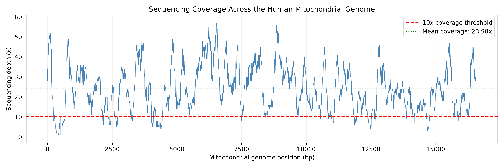
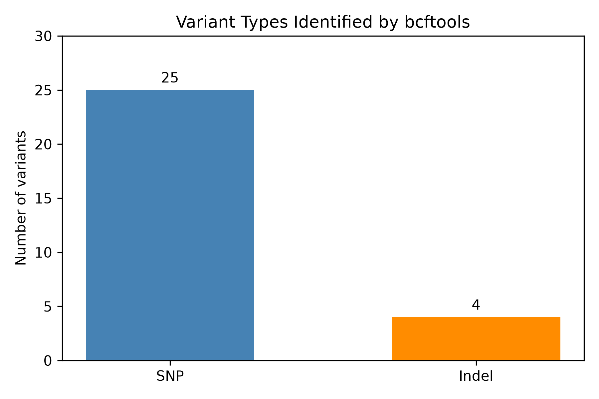
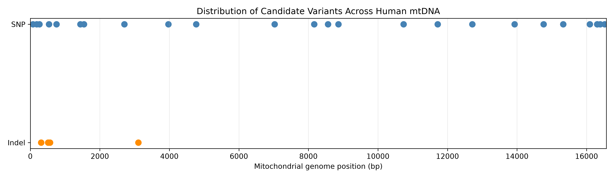
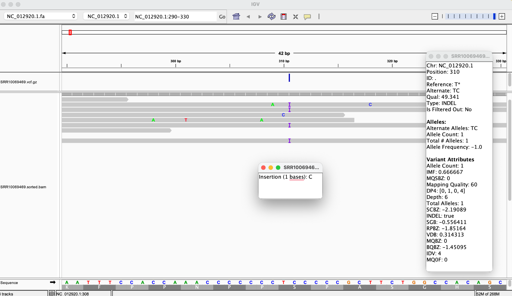
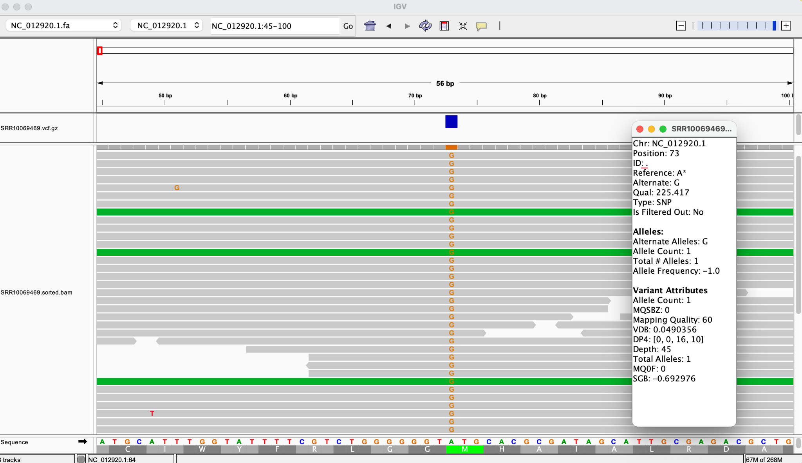
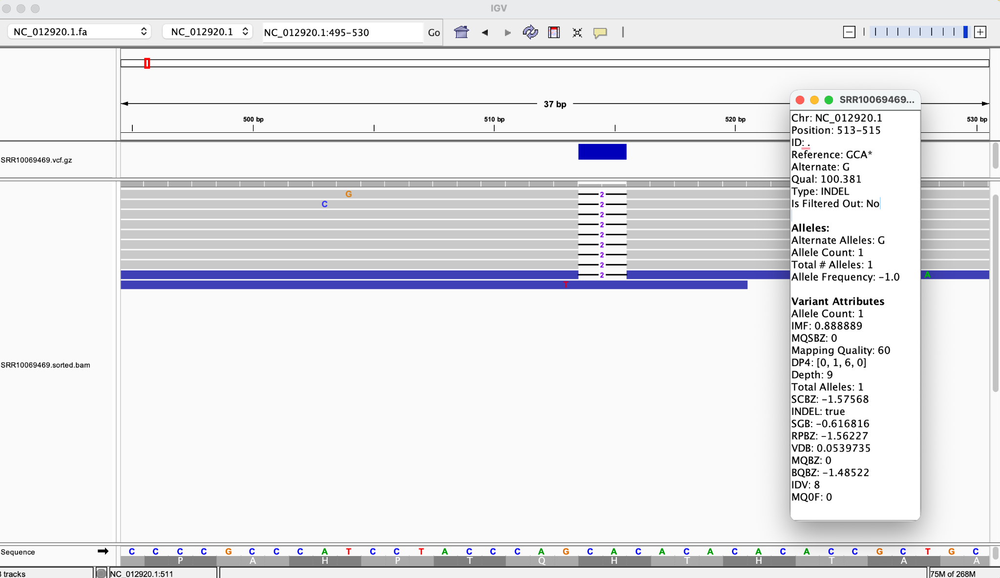

# Week 07: Variant Calling Using Human Mitochondrial DNA

## Objective

The goal of this assignment was to extend the previous read-alignment workflow to identify sequence variants, generate a VCF file, examine variant statistics, and evaluate candidate variants using IGV.

## Dataset and Reference

- **SRA accession:** SRR10069469
- **Reference genome:** Human mitochondrial DNA (NC_012920.1)
- **Reference length:** 16,569 bp
- **Sequencing:** Paired-end reads
- **Reads downloaded:** 1,500 read pairs
- **Reads retained after filtering:** 1,464 read pairs

## Workflow

The analysis was automated using a Makefile.

1. Download paired-end reads using SRA Toolkit.
2. Assess raw read quality using FastQC.
3. Trim and filter reads using fastp.
4. Align reads to the mitochondrial reference using BWA-MEM.
5. Sort and index the BAM file using samtools.
6. Calculate sequencing coverage using samtools depth.
7. Call variants using bcftools mpileup and bcftools call.
8. Normalize and sort the variants using bcftools norm and sort.
9. Generate VCF statistics using bcftools stats.
10. Inspect selected variants in IGV.

Variant calling used a haploid model (`--ploidy 1`) for mitochondrial DNA. This analysis identifies consensus candidate variants rather than specifically modeling low-frequency heteroplasmy.

## Reproducing the Analysis

Run the following commands from the repository root:

```bash
cd week07
make all
```

The workflow requires SRA Toolkit, FastQC, fastp, BWA, samtools, and bcftools.

To generate the visualizations:

```bash
python plot_coverage.py
python plot_variants.py
```

The plotting scripts require Python, pandas, and matplotlib.

## Sequencing Coverage

| Metric | Result |
|---|---:|
| Reference genome length | 16,569 bp |
| Mean sequencing depth | 23.98× |
| Genome covered at ≥1× | 99.99% |
| Genome covered at ≥10× | 91.01% |

The mean sequencing depth exceeded the required 10× coverage. However, coverage was not uniform across the genome.



## Variant Calling Results

A total of **29 candidate variants** were identified.

| Variant type | Number |
|---|---:|
| SNPs | 25 |
| Indels | 4 |
| Total | 29 |

The four indels included two insertions and two deletions.





## IGV Inspection

Selected candidate variants were examined in IGV to assess their support from aligned reads.

### SNP at Position 73

- Reference allele: A
- Alternative allele: G
- QUAL: 225.417
- Reported depth: 45×

The alternative G allele was consistently observed in the aligned reads. The variant had high read depth and support from both forward and reverse reads, making it a strongly supported candidate sequence difference relative to the reference.



### Insertion at Position 310

- Reference allele: T
- Alternative allele: TC
- QUAL: 49.341
- Reported depth: 6×

IGV showed multiple reads containing the C insertion. However, the site had relatively low depth and occurred in a C-rich repetitive region, making the exact indel call less certain.



### Deletion at Position 513

- Reference allele: GCA
- Alternative allele: G
- QUAL: 100.381
- Reported depth: 9×

IGV showed several reads with a two-base deletion. Although the deletion had visible alignment support, the low depth and possible strand imbalance suggest that it should be interpreted cautiously.



## Discussion

The analysis identified 29 candidate variants relative to the human mitochondrial reference genome. Most were SNPs, while four were indels.

IGV inspection showed that variant confidence depended on more than the VCF quality score. The SNP at position 73 had strong support from multiple aligned reads, whereas the insertion at position 310 and deletion at position 513 had lower depth and greater uncertainty.

These observations demonstrate why visual inspection of read alignments is useful when evaluating variant calls, particularly in repetitive regions.

## Main Output Files

- `results/alignment/SRR10069469.sorted.bam`
- `results/alignment/coverage_summary.txt`
- `results/variants/SRR10069469.vcf.gz`
- `results/variants/variant_stats.txt`
- `images/coverage_plot.png`
- `images/variant_distribution.png`
- `images/variant_types.png`
- `images/igv_snp_73.png`
- `images/igv_insertion_310.png`
- `images/igv_deletion_513.png`

## Conclusion

The Makefile successfully automated read processing, alignment, and variant calling. Mean genome coverage reached 23.98×, and bcftools identified 29 candidate variants. IGV inspection provided additional evidence for assessing the reliability of selected SNPs and indels.
