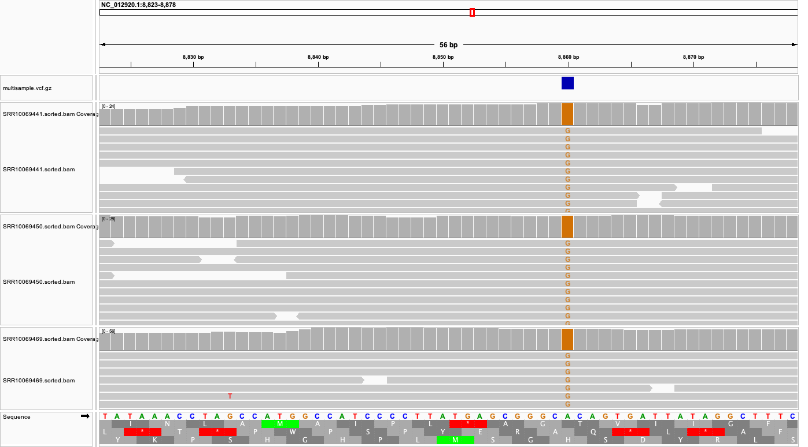

# Week 08: Predict Variant Effects

## Objective

The objective of this assignment was to identify genetic variants in three biological samples, generate a multisample VCF, and predict how coding variants affect amino acid sequences.

I used human mitochondrial DNA as the reference genome and examined the predicted effects of variants in mitochondrial protein-coding genes.

## Data

Three human sequencing runs from BioProject PRJNA563929 were analyzed.

| SRA accession | Biological sample |
|---|---|
| SRR10069469 | SAMN12696359 |
| SRR10069441 | SAMN12696348 |
| SRR10069450 | SAMN12696339 |

Reference genome: NC_012920.1 (human mitochondrial DNA, 16,569 bp).

The corresponding NCBI GenBank annotation was used to identify protein-coding regions and predict amino acid changes.

## Methods

1. Downloaded the first 1,500 paired-end sequencing spots from each SRA run.
2. Trimmed reads using fastp with a Phred quality threshold of 20 and a minimum read length of 50 bp.
3. Aligned reads to the mitochondrial reference genome using BWA-MEM.
4. Sorted and indexed the alignments using SAMtools.
5. Performed joint variant calling across all three samples using BCFtools.
6. Generated a compressed, indexed multisample VCF.
7. Used a Python script with Biopython and GenBank coding-sequence annotations to predict coding variant effects.
8. Visualized a selected variant and its translated reference sequence in IGV.

The variant annotation script uses the vertebrate mitochondrial genetic code (translation table 2).

## Results

The multisample VCF contained 76 variant records across three biological samples.

The coding-effect annotation produced:

- 33 synonymous annotations
- 13 missense annotations

These counts refer to coding annotations rather than necessarily unique genomic positions.

### Example: MT-ATP6 missense variant

A variant at mitochondrial position 8860 was selected for detailed examination.

| Feature | Result |
|---|---|
| Gene | MT-ATP6 |
| Position | 8860 |
| Reference allele | A |
| Alternative allele | G |
| Reference codon | ACA |
| Alternative codon | GCA |
| Reference amino acid | Threonine (T) |
| Alternative amino acid | Alanine (A) |
| Protein change | p.Thr112Ala |
| Predicted effect | Missense |

The alternative allele was called in all three samples.

The predicted amino acid substitution changes threonine to alanine at position 112 of the ATP6 protein. This is a predicted coding consequence and does not establish pathogenicity.

## IGV Visualization

The following screenshot shows the MT-ATP6 variant at position 8860, aligned sequencing reads from all three samples, the reference DNA sequence, and amino acid translation frames.



The reference codon ACA encodes threonine. Replacing A with G at position 8860 changes the codon to GCA, which encodes alanine.

## Reproducibility

The analysis uses GNU Make to organize the workflow.

From the repository root:

```bash
make -C week08
```

To display sample names, variant counts, and annotation counts:

```bash
make -C week08 stats
```

The Week 08 Makefile reuses the mitochondrial reference and the first sample's trimmed reads from Week 07. These files must be available to reproduce the workflow from scratch.

### Software

- SRA Toolkit: sequence retrieval
- fastp: read quality filtering and trimming
- BWA-MEM: sequence alignment
- SAMtools: alignment processing and indexing
- BCFtools: joint variant calling
- Python and Biopython: coding-effect annotation
- IGV: visual inspection of variants

## Important Files

| File | Description |
|---|---|
| Makefile | Reproducible analysis workflow |
| scripts/annotate_variants.py | Python coding-effect annotation script |
| results/variants/multisample.vcf.gz | Jointly called variants for three samples |
| results/variants/multisample.vcf.gz.csi | VCF index |
| results/variants/variant_effects.tsv | Predicted coding variant effects |
| figures/igv_atp6_8860.png | IGV visualization of the selected variant |
| data/reference/NC_012920.1.gb | Reference genome annotation |

## Limitations

Only the first 1,500 paired-end sequencing spots from each sample were analyzed, so results may differ from analyses using the full sequencing datasets.

The variant-calling workflow used a haploid model and did not explicitly estimate mitochondrial heteroplasmy.

The annotation script evaluates single-nucleotide substitutions in protein-coding regions. It does not provide clinical pathogenicity classifications.

## Directory Structure

```text
week08/
├── Makefile
├── README.md
├── data/
│   ├── raw/                 # Downloaded FASTQ files
│   ├── trimmed/             # Quality-filtered FASTQ files
│   └── reference/
│       └── NC_012920.1.gb
├── scripts/
│   └── annotate_variants.py
├── results/
│   ├── alignment/           # Sorted BAM files and indexes
│   ├── fastp/               # Quality-control reports
│   └── variants/
│       ├── multisample.vcf.gz
│       ├── multisample.vcf.gz.csi
│       └── variant_effects.tsv
└── figures/
    └── igv_atp6_8860.png
```
