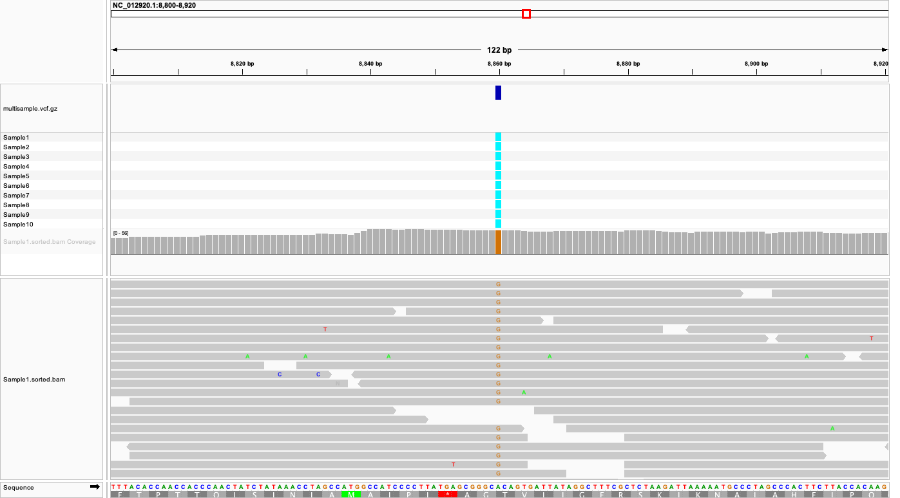

# Week 09: Automated Variant Calling Across Multiple Samples

## Overview

This workflow automates mitochondrial DNA variant calling for 10 human samples from NCBI BioProject **PRJNA563929**, which investigates mitochondrial DNA in type 2 diabetes. It extends the previous variant-calling workflow by using a metadata design file and GNU Parallel to process multiple samples.

The reference genome is the human mitochondrial sequence **NC_012920.1**.

## Requirements

Run the workflow in the course `bioinfo` environment. It uses GNU Make, GNU Parallel, SRA Toolkit (`prefetch`, `fastq-dump`), fastp, BWA, SAMtools, and BCFtools. No tools are installed automatically.

## Reproduce the analysis

From the `week09` directory, run:

```bash
make batch JOBS=2 THREADS=2
```

To preview the workflow without executing it:

```bash
make -n SRR=SRR10069469 SAMPLE_NAME=Sample1 all
```

The `design.csv` file contains 10 sequencing run accessions, BioSample identifiers, and unique sample names. GNU Parallel reads this file to run the same analysis for each sample.

Each sample is processed using 1,500 paired-end sequencing spots, fastp quality filtering (Phred 20; minimum read length 50 bp), BWA alignment, and haploid variant calling with BCFtools.

## Outputs

Individual sample VCF files are written to `results/variants/`. The final combined VCF is:

`results/variants/multisample.vcf.gz`

The 10-sample analysis produced **174 VCF records**. These records are not necessarily 174 unique genomic positions.

**Limitation:** The merge command uses `bcftools merge -0`, which fills missing calls with reference genotypes. These should not be interpreted as independently verified reference calls.

## Reproducibility

The Makefile uses the included mitochondrial reference genome, and the design file determines which samples are processed. No files from previous assignment weeks are required.

## Coverage and IGV visualization

All 10 samples had more than 98% mitochondrial genome coverage, with mean sequencing depths ranging from 20.17× to 23.98×. Sample1 covered 99.99% of the 16,569-bp reference genome, with an average depth of 23.98×.

The merged VCF was visualized in IGV alongside the Sample1 BAM alignment. At mitochondrial position 8860, an A-to-G substitution was observed in the MT-ATP6 gene. Multiple aligned reads support the alternate G allele, and the variant appears in the VCF genotype tracks for all 10 samples.



**Figure 1.** IGV visualization of the mitochondrial region around position 8860 (NC_012920.1), showing the merged VCF genotype tracks for 10 samples and the Sample1 read alignments. The colored G bases indicate reads supporting the alternate allele.

Although the average sequencing coverage is sufficient for exploratory variant calling, individual variants require additional quality assessment. Also, reference genotypes introduced during VCF merging should not be treated as independently confirmed calls.

## Project structure

```text
week09/
├── Makefile                  # Automates the workflow
├── README.md                 # Documentation and findings
├── design.csv                # Metadata for 10 samples
├── data/
│   ├── raw/                  # Downloaded sequencing reads
│   └── reference/            # Mitochondrial reference genome
├── results/
│   ├── trimmed/              # Quality-filtered reads
│   ├── fastp/                # Quality-control reports
│   ├── alignment/            # BAM files and indexes
│   └── variants/             # Individual and merged VCF files
└── figures/
    └── igv_atp6_8860.png     # IGV visualization
```

Raw sequencing data and intermediate files are generated locally and do not need to be uploaded to GitHub.
