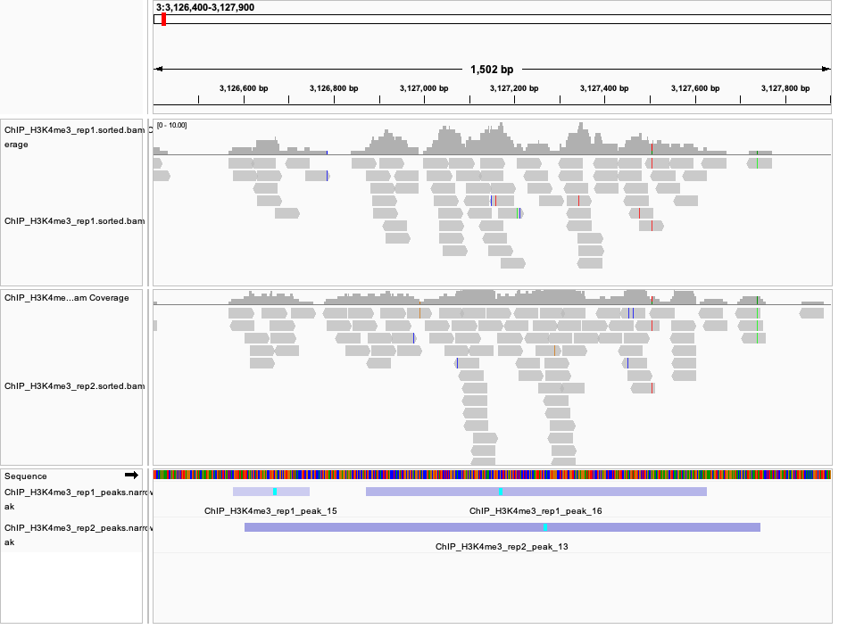
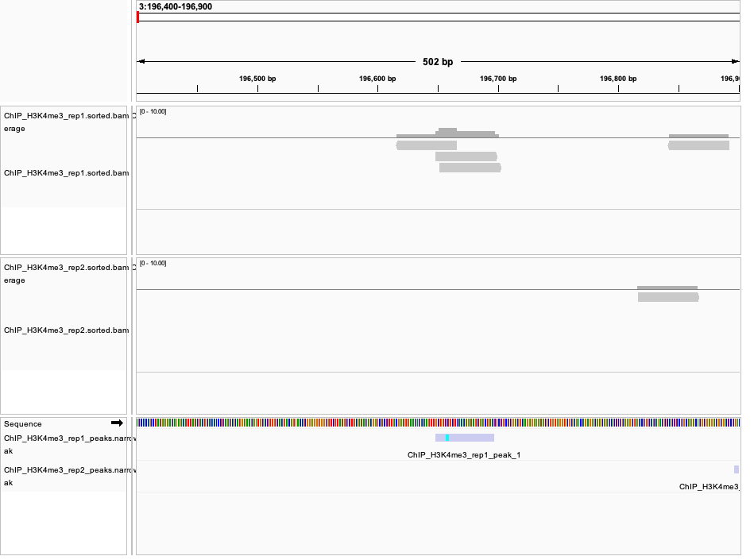

# BMMB 852 — Week 10: ChIP-seq Peak Calling

## 1. Objective

The objective of this assignment is to build an automated ChIP-seq analysis workflow, identify genomic regions enriched for histone modifications, and compare peak calls between replicates.

The workflow uses SRA Toolkit, fastp, BWA, SAMtools, MACS3, BEDTools, and GNU Make. The resulting alignments and peaks are visualized in IGV.

## 2. Dataset

**BioProject:** PRJNA214613

The dataset contains ChIP-seq experiments targeting three histone modifications:

- H3K4me1
- H3K4me3
- H3K27ac

Each histone modification has two replicates. One shared input DNA sample is used as the background control.

| SRA Run | Sample | Experiment |
|---|---|---|
| SRR949136 | ChIP_H3K4me1_rep1 | H3K4me1 |
| SRR949137 | ChIP_H3K4me1_rep2 | H3K4me1 |
| SRR949138 | ChIP_H3K4me3_rep1 | H3K4me3 |
| SRR949139 | ChIP_H3K4me3_rep2 | H3K4me3 |
| SRR949140 | ChIP_H3K27ac_rep1 | H3K27ac |
| SRR949141 | ChIP_H3K27ac_rep2 | H3K27ac |
| SRR949142 | ChIP_Input | Input control |

The sample metadata are recorded in `design.csv`.

### Reference Genome

Human reference genome GRCh38, chromosome 3, was downloaded from Ensembl release 115.

The reference was indexed using BWA and SAMtools.

Only chromosome 3 was analyzed to reduce computational requirements.

## 3. Analysis Workflow

The analysis was adapted from the automated workflow developed in previous BMMB 852 assignments.

### Step 1: Download sequencing reads

SRA Toolkit was used to download the sequencing data.

The analysis was limited to the first 1,500,000 reads per sample.

```bash
prefetch SRR949136
fastq-dump -X 1500000 --outdir data/raw SRR949136
```

### Step 2: Quality filtering

FASTQ reads were processed using fastp.

Reads were filtered using a Phred quality threshold of 20 and a minimum length of 50 bases.

```bash
fastp \
  -i data/raw/SRR949136.fastq \
  -o results/trimmed/ChIP_H3K4me1_rep1.fastq \
  -q 20 \
  -l 50 \
  -w 2
```

### Step 3: Read alignment

Filtered reads were aligned to human chromosome 3 using BWA-MEM.

```bash
bwa mem -t 2 \
  data/reference/chr3.fa \
  results/trimmed/ChIP_H3K4me1_rep1.fastq |
  samtools sort -@ 2 \
  -o results/alignment/ChIP_H3K4me1_rep1.sorted.bam -
```

The resulting BAM files were indexed using SAMtools.

```bash
samtools index results/alignment/ChIP_H3K4me1_rep1.sorted.bam
```

### Step 4: Peak calling

MACS3 was used to identify genomic regions enriched for histone modifications relative to the input control.

Narrow-peak calling was performed using:

```bash
macs3 callpeak \
  -t results/alignment/ChIP_H3K4me3_rep1.sorted.bam \
  -c results/alignment/ChIP_Input.sorted.bam \
  -f BAM \
  -g 3e8 \
  -q 0.01 \
  -n ChIP_H3K4me3_rep1 \
  --outdir results/peaks
```

For H3K4me1, broad-peak calling was additionally performed:

```bash
macs3 callpeak \
  -t results/alignment/ChIP_H3K4me1_rep1.sorted.bam \
  -c results/alignment/ChIP_Input.sorted.bam \
  -f BAM \
  -g 3e8 \
  --broad \
  --broad-cutoff 0.1 \
  -n ChIP_H3K4me1_rep1 \
  --outdir results/peaks_broad
```

The same broad-peak settings were used for H3K4me1 replicate 2.

### Step 5: Replicate comparison

BEDTools was used to identify peaks that overlapped between replicates.

For example:

```bash
bedtools intersect \
  -a results/peaks/ChIP_H3K4me3_rep1_peaks.narrowPeak \
  -b results/peaks/ChIP_H3K4me3_rep2_peaks.narrowPeak \
  -u | wc -l
```

The `-u` option reports each peak in the first file that overlaps at least one peak in the second file.

The comparison was repeated in both directions.

## 4. Automated Workflow

The Makefile automates the major processing steps.

To process all samples:

```bash
make batch JOBS=2 THREADS=2
```

To call narrow peaks:

```bash
make peaks JOBS=2 THREADS=2
```

The workflow processes the input control first, followed by the ChIP-seq samples.

The directory structure is:

```text
week10/
├── Makefile
├── README.md
├── design.csv
├── igv_agreement.png
├── igv_disagreement.png
├── data/
│   ├── raw/
│   └── reference/
└── results/
    ├── trimmed/
    ├── fastp/
    ├── alignment/
    ├── peaks/
    └── peaks_broad/
```

## 5. Peak Calling Results

MACS3 generated the following peak counts for chromosome 3.

| Histone Modification | Replicate 1 | Replicate 2 | Peak Type |
|---|---:|---:|---|
| H3K4me1 | 159 | 221 | Broad |
| H3K4me3 | 3,775 | 2,141 | Narrow |
| H3K27ac | 2,653 | 2,651 | Narrow |

### H3K4me1

Initial narrow-peak calling detected only two peaks in each replicate.

Because H3K4me1 is associated with enhancer regions that may show relatively broad enrichment, broad-peak calling was tested.

Broad-peak calling increased the detected peaks to 159 in replicate 1 and 221 in replicate 2.

### H3K4me3

H3K4me3 replicate 1 contained 3,775 peaks, compared with 2,141 peaks in replicate 2.

The difference suggests variation in the number of enriched regions detected between the replicates.

### H3K27ac

H3K27ac showed nearly identical peak counts between replicates:

- Replicate 1: 2,653 peaks
- Replicate 2: 2,651 peaks

However, similar peak counts do not necessarily indicate that peaks occur at the same genomic locations.

## 6. Replicate Overlap Analysis

The number of peaks overlapping between replicates was calculated using BEDTools.

| Histone Modification | Rep1 Overlapping Rep2 | Rep2 Overlapping Rep1 |
|---|---:|---:|
| H3K4me1 | 18/159 (11.3%) | 18/221 (8.1%) |
| H3K4me3 | 2,176/3,775 (57.6%) | 1,337/2,141 (62.4%) |
| H3K27ac | 1,203/2,653 (45.3%) | 1,313/2,651 (49.5%) |

### Interpretation

H3K4me3 had the highest proportion of overlapping peaks among the three histone modifications.

H3K27ac showed moderate peak-level agreement despite having nearly identical total peak counts.

H3K4me1 showed low overlap between replicates, indicating that the detected enriched regions were less consistent.

The overlap percentages are directional because one peak in one replicate may overlap multiple peaks in the other replicate.

These measurements represent simple genomic interval overlap and should not be interpreted as formal reproducibility statistics.

## 7. IGV Visualization

IGV was used to visualize the aligned reads, coverage tracks, and MACS3 peak calls.

The human GRCh38 chromosome 3 reference was loaded, followed by the H3K4me3 BAM files and narrowPeak files.

### Figure 1. Region of agreement between replicates

**Genomic region:** chr3:3,126,400–3,127,900



Both H3K4me3 replicates show sequencing coverage across this region.

MACS3 detected overlapping peaks:

- Replicate 1: peaks 15 and 16
- Replicate 2: peak 13

The overlapping peak intervals and similar enrichment patterns indicate agreement between the two replicates in this region.

### Figure 2. Region of disagreement between replicates

**Genomic region:** chr3:196,400–196,900



MACS3 identified a peak in replicate 1 at approximately chr3:196,648–196,697.

No corresponding overlapping peak was identified in replicate 2.

The sequencing coverage is low in this region, so this example illustrates disagreement in peak calling rather than strong evidence of a biological difference.

## 8. Limitations

Several limitations should be considered when interpreting these results.

1. **Partial genome analysis:** Only chromosome 3 was analyzed rather than the complete human genome.

2. **Read subsampling:** The analysis used up to 1,500,000 reads per sample, which may reduce peak detection sensitivity.

3. **Input control:** The dataset contains one shared input control rather than two independent input replicates.

4. **Fragment-length estimation:** MACS3 reported warnings about short estimated fragment lengths for some samples.

5. **Peak-calling parameters:** Narrow-peak and broad-peak calling can produce substantially different results, especially for H3K4me1.

6. **Replicate reproducibility:** Simple peak overlap does not account for differences in sequencing depth, peak strength, or statistical reproducibility.

## 9. Conclusion

An automated ChIP-seq peak-calling workflow was developed using GNU Make, SRA Toolkit, fastp, BWA, SAMtools, and MACS3.

The workflow successfully processed seven sequencing samples, including six ChIP-seq replicates and one shared input control.

Peak counts differed across histone modifications and replicates. H3K4me3 showed the highest peak-overlap percentages, followed by H3K27ac, while H3K4me1 showed substantially lower agreement.

IGV visualization demonstrated examples of both agreement and disagreement between H3K4me3 replicates.

Overall, the analysis demonstrates how sequencing reads can be processed to identify enriched genomic regions and how replicate comparisons can help evaluate the consistency of ChIP-seq results.

## 10. Software

- GNU Make
- SRA Toolkit (`prefetch`, `fastq-dump`)
- fastp
- BWA-MEM
- SAMtools
- MACS3
- BEDTools
- GNU Parallel
- IGV

## 11. References

- NCBI Sequence Read Archive: https://www.ncbi.nlm.nih.gov/sra
- BioProject PRJNA214613: https://www.ncbi.nlm.nih.gov/bioproject/PRJNA214613
- Ensembl: https://www.ensembl.org/
- MACS3: https://macs3-project.github.io/MACS/
- BEDTools: https://bedtools.readthedocs.io/
- IGV: https://igv.org/
