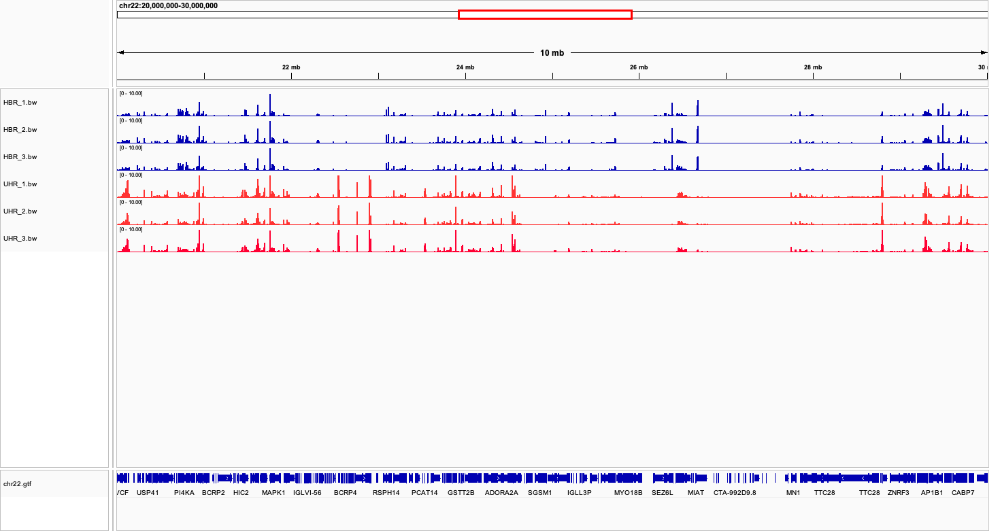
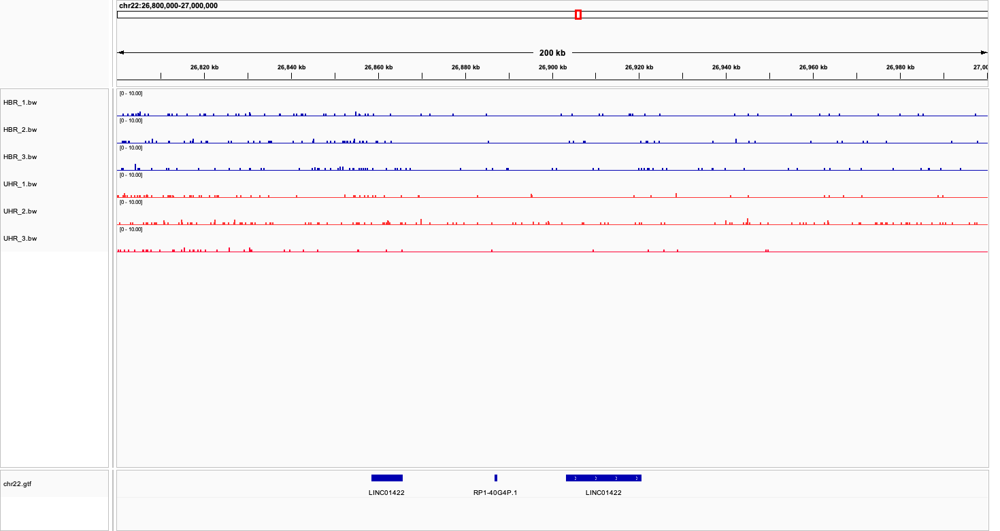
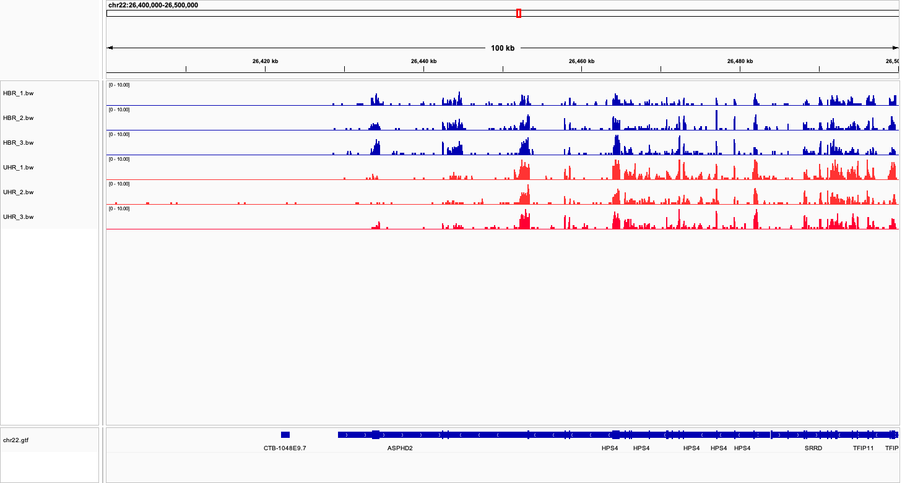
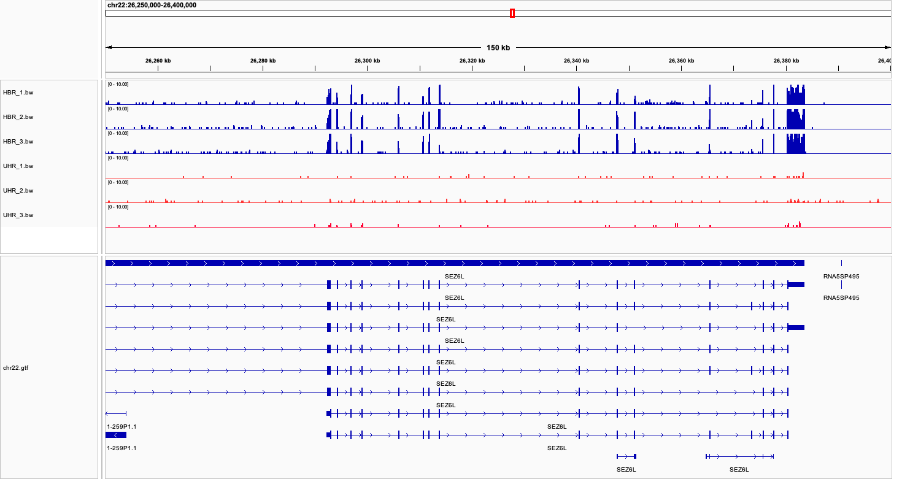

# Week 11 — RNA-seq Gene Expression Analysis

## Objective

Compare gene expression between Human Brain Reference (HBR) and Universal Human Reference (UHR) RNA samples using RNA-seq data from human chromosome 22.

## Dataset

- Reference genome: Human chromosome 22
- Gene annotation: chr22.gtf
- HBR: 3 replicates
- UHR: 3 replicates
- Sequencing: Single-end RNA-seq

## Tools

- HISAT2 — RNA-seq read alignment
- SAMtools — BAM sorting and indexing
- deepTools (bamCoverage) — BigWig coverage generation
- featureCounts — Gene-level read counting
- IGV — Visualization of gene expression

## Workflow

1. Downloaded the chromosome 22 reference genome, annotation, and six FASTQ files.
2. Built the HISAT2 reference index using `make index`.
3. Aligned reads and generated BAM and BigWig files using `make align` and `make batch`.
4. Generated gene-level counts using featureCounts.
5. Loaded all six BigWig files and the GTF annotation into IGV.
6. Compared expression patterns between HBR and UHR.

## Assignment Questions

### 1. How does gene expression differ between HBR and UHR?

HBR and UHR show different expression patterns across chromosome 22. Some genomic regions have stronger coverage in HBR, while others have stronger coverage in UHR. This indicates differences in gene expression between the two sample types.

### 2. How consistent are the replicates?

The three replicates within each group show similar coverage patterns. Most prominent peaks occur at the same genomic locations, suggesting good reproducibility.

### 3. Identify a gene that is not expressed in any sample.

LINC01422 showed very low coverage across all six samples. It is a candidate for a gene with little or no detectable expression, although a few small coverage peaks were visible.

### 4. Identify a gene strongly expressed in all samples. What is its coverage?

HPS4 showed clear coverage peaks in all six samples. Several peaks reached approximately 10 or more reads per base on the displayed IGV scale.

### 5. Can specific transcript isoforms be identified?

HPS4 has multiple annotated transcript isoforms. Although RNA-seq coverage supports expression of the gene, the exact isoform is difficult to identify because several transcripts share exons. Splice-junction evidence would help distinguish them.

### 6. Identify a differentially expressed gene. What is its fold change?

SEZ6L showed much higher expression in HBR than UHR.

| Sample | SEZ6L counts | Total assigned reads |
|--------|-------------:|---------------------:|
| HBR_1 | 399 | 39289 |
| HBR_2 | 507 | 48402 |
| HBR_3 | 461 | 42844 |
| UHR_1 | 15 | 67210 |
| UHR_2 | 14 | 43818 |
| UHR_3 | 21 | 53725 |

Counts were normalized to counts per million (CPM) using the total assigned reads in each sample.

The mean normalized expression was approximately 10,463 CPM in HBR and 311 CPM in UHR.

**Estimated fold change (HBR/UHR): approximately 33.6-fold.**

### 7. Is the transcript upregulated or downregulated?

SEZ6L is upregulated in HBR relative to UHR.

### 8. How certain are we that the difference is not random?

All three HBR replicates consistently showed much higher SEZ6L expression than all three UHR replicates. This supports a reproducible expression difference.

However, no formal statistical differential-expression test was performed, so statistical significance cannot be established from these observations alone.

## Conclusion

RNA-seq coverage visualization revealed differences in gene expression between HBR and UHR samples. SEZ6L was approximately 33.6-fold more highly expressed in HBR based on CPM-normalized gene counts. Replicates showed consistent expression patterns within each group.

## IGV Figures

### Figure 1. Genome-wide HBR vs. UHR expression

### Figure 2. Low expression of LINC01422

### Figure 3. HPS4 expression in all six samples

### Figure 4. SEZ6L differential expression and transcript isoforms

