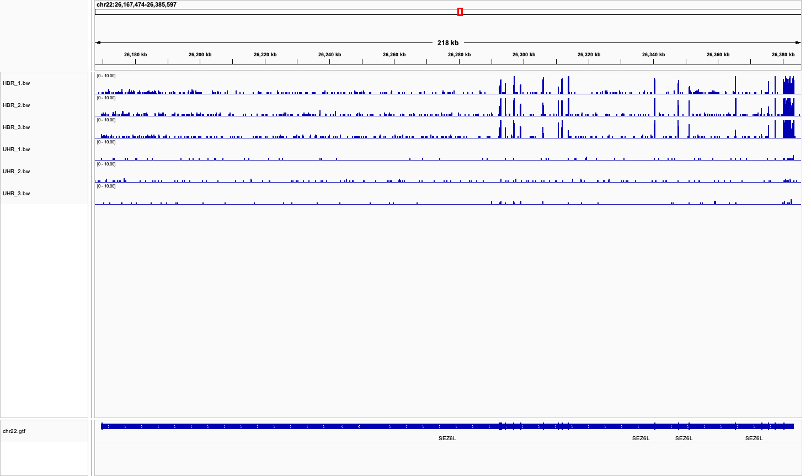

# Week 12: Transcript-Based RNA-seq Quantification

## Objective

Generate two count matrices from transcript-based RNA-seq quantification using Salmon:

1. A transcript-level count matrix containing estimated read counts for each transcript.
2. A gene-level count matrix obtained by summing the counts of transcripts belonging to the same gene.

## Data

Six RNA-seq samples were analyzed:

- HBR: HBR_1, HBR_2, HBR_3
- UHR: UHR_1, UHR_2, UHR_3

The analysis uses chromosome 22 transcript sequences, gene annotations, and FASTQ files from Week 11.

## Tools

- Salmon
- R
- GNU Make
- Pixi

## Workflow

**1. Build the Salmon index**

The chromosome 22 transcript reference was indexed using Salmon with a k-mer size of 31.

**2. Quantify transcript abundance**

Salmon was run separately on each of the six single-end RNA-seq samples. Each sample produced a `quant.sf` file containing transcript IDs, TPM values, and estimated read counts.

**3. Generate the transcript count matrix**

Run:

`Rscript src/combine_transcript_counts.r`

The script combines Salmon's `NumReads` estimates across all six samples.

**4. Generate the gene count matrix**

Run:

`Rscript src/combine_transcripts_as_genes.r`

The script uses the GTF annotation to match transcript IDs to gene IDs and gene names, then sums transcript counts by gene.

**5. Automate the workflow**

Run:

`make matrices`

The Makefile automates Salmon quantification and count matrix generation.

The workflow reuses reference files and FASTQ data stored in the Week 11 directory.

## Results

**Transcript count matrix**

- File: `results/transcript_counts.csv`
- 4,501 transcripts
- 6 samples

**Gene count matrix**

- File: `results/transcripts_as_genes.csv`
- 1,369 genes
- 6 samples

Both matrices contain estimated read counts. The gene-level matrix also includes gene IDs and gene names.

## Validation: SEZ6L

SEZ6L showed substantially higher estimated read counts in HBR samples than in UHR samples.

| Sample | Estimated counts |
|---|---:|
| HBR_1 | 396 |
| HBR_2 | 502 |
| HBR_3 | 458.001 |
| UHR_1 | 15 |
| UHR_2 | 14 |
| UHR_3 | 19 |

The average raw count was approximately 452 in HBR and 16 in UHR, consistent with the expression pattern observed in Week 11.

## AI-Assisted Programming

ChatGPT was used to help develop the R scripts, organize the analysis workflow, and troubleshoot errors.

The scripts were tested using the six Salmon quantification files. The resulting count matrices were checked for the expected dimensions and expression patterns.

## Challenges and Solutions

- **Salmon was missing:** Installed Salmon using Pixi.
- **R was missing:** Installed R using Pixi.
- **Makefile error:** Encountered a missing separator error caused by incorrect indentation. Corrected the indentation and reran the workflow successfully.
- **Transcript-to-gene mapping:** Used the GTF annotation to associate transcript IDs with gene IDs and gene names before aggregating counts.
- **Validation:** Compared SEZ6L expression between HBR and UHR samples to check consistency with Week 11.

## Files

- `Makefile`: Automates transcript quantification and matrix generation.
- `src/combine_transcript_counts.r`: Generates the transcript-level count matrix.
- `src/combine_transcripts_as_genes.r`: Generates the gene-level count matrix.
- `results/transcript_counts.csv`: Final transcript count matrix.
- `results/transcripts_as_genes.csv`: Final gene count matrix.

## IGV Visualization

The six RNA-seq coverage tracks and chromosome 22 GTF annotation were visualized in IGV at the SEZ6L gene region (chr22:26,167,474–26,385,597).

The HBR samples showed substantially higher coverage than the UHR samples, consistent with the Salmon-derived gene counts.

